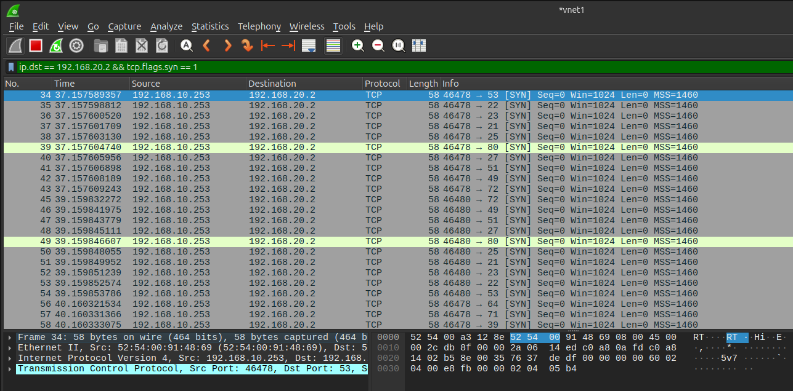

# Lab Write-up: VLAN-to-VLAN SYN Scan & Firewall Drop Analysis

* **Focus:** Network Traffic Analysis (Wireshark), VLAN Segmentation, Firewall Drop Behavior
* **Host OS:** Ubuntu (native dual-boot)
* **Hypervisor:** KVM (`virbr0` Ubuntu for internet access via NAT)

## Lab Topology
* **Router:** Mikrotik RouterOS (inside KVM) connected to the internet via Ubuntu's `virbr0`.
* **VLAN10:** Ubuntu virtual switch (Linux bridge) (`br-vlan`) connected to Kali Linux inside KVM.
* **VLAN20:** Ubuntu virtual switch (Linux bridge) (`br-vlan01`) connected to Alpine Linux inside KVM.
* **Tools:** Mikrotik RouterOS, Wireshark, and `nmap`.
* **Objective:** To analyze network traffic by capturing the Mikrotik bridge in Wireshark during a port scan using TCP SYN and firewall filtering with rules that drop traffic from VLAN10 to VLAN20 without an RST response.

## Topology & Initial Configuration
* **Mikrotik RouterOS:**
  * Firewall Filter: Allow established & related connections, Drop invalid connections, and Block traffic from VLAN10 to VLAN20.
  * Bridge: Bridge-LAN (VLAN10 & VLAN20)
  * Static ARP Table: Yes
  * Static DHCP: Yes
* **Kali Linux:** Subnet `192.168.10[.]0/24`, IP `192.168.10[.]253`, gateway `192.168.10[.]1`
* **Alpine Linux:** Subnet `192.168.20[.]0/24`, IP `192.168.20[.]2`, gateway `192.168.20[.]1`
* **NAT:** `virbr0` (Ubuntu host)

## Steps
1. **Kali Linux (VLAN10)** performs a port scan of ports `20–100` using an `nmap` SYN scan on Alpine Linux (VLAN20):
   ```bash
   nmap -sS -Pn -p 20-100 192.168.20.2
   ```
2. **Analyze traffic in Wireshark** on the Ubuntu host (capture interface: `bridge-LAN`) using the filter:
   ```text
   ip.dst == 192.168.20.2 && tcp.flags.syn == 1
   ```

## Findings
1. Heavy TCP SYN traffic from the IP address `192.168.10[.]253` with no response, as the packets were immediately and silently blocked by the firewall without sending a reply.

<p align="center">
  
</p>

## Conclusion
By analyzing suspicious traffic—such as a large number of TCP SYN packets being sent to multiple ports from a single IP address, which indicates port scanning—it is possible to detect the potential for a follow-up attack. Before such an attack occurs, any open sensitive ports should be closed or restricted using firewall filtering with sufficiently strict rules.
