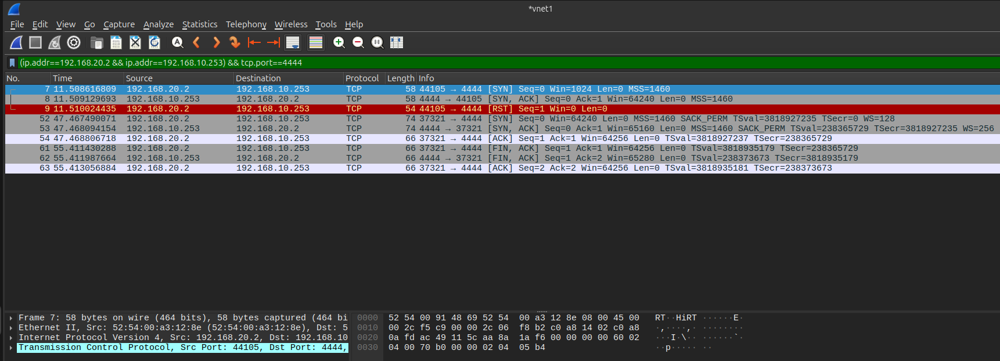

# Lab Write-up: Analysis of SYN scan traffic on open ports without a firewall and normal traffic activity

* **Focus:** Network Traffic Analysis (Wireshark), VLAN Segmentation.
* **Host OS:** Ubuntu (native dual-boot)
* **Hypervisor:** KVM (`virbr0` Ubuntu for internet access via NAT)

## Lab Topology
* **Router:** Mikrotik RouterOS (inside KVM) connected to the internet via Ubuntu's `virbr0`.
* **VLAN10:** Ubuntu virtual switch (Linux bridge) (`br-vlan`) connected to Kali Linux inside KVM.
* **VLAN20:** Ubuntu virtual switch (Linux bridge) (`br-vlan01`) connected to Alpine Linux inside KVM.
* **Tools:** Mikrotik RouterOS, Wireshark, and `nmap`.
* **Objective:** To analyze network traffic by capturing the Mikrotik bridge in Wireshark during a port scan using TCP SYN without firewall filtering rules from VLAN20 to VLAN10.

## Topology & Initial Configuration
* **Mikrotik RouterOS:**
  * Firewall Filter: Allow established & related connections, Drop invalid connections, and Block traffic from VLAN10 to VLAN20 (asymmetric firewall).
  * Bridge: Bridge-LAN (VLAN10 & VLAN20)
  * Static ARP Table: Yes
  * Static DHCP: Yes
* **Kali Linux:** Subnet `192.168.10[.]0/24`, IP `192.168.10[.]253`, gateway `192.168.10[.]1`
* **Alpine Linux:** Subnet `192.168.20[.]0/24`, IP `192.168.20[.]2`, gateway `192.168.20[.]1`
* **NAT:** `virbr0` (Ubuntu host)

## Steps
1. **Kali Linux (VLAN10)** open port `4444` using `netcat` :
   ```bash
   nc -lvnp 4444
   ```

2. **Alpine Linux (VLAN20)** 

   performs a port scan on port `4444` using an `nmap` SYN scan on Kali Linux (VLAN10):
   ```bash
   nmap -sS -Pn -p 4444 192.168.10.253
   ```
   using natcat to open port listening to port `4444` on Kali Linux:
   ```bash
   nc -v 192.168.10.253 4444
   ```
   then, `cntrl+C` to stop the connection

3. **Analyze traffic in Wireshark** on the Ubuntu host (capture interface: `bridge-LAN`) using the filter:
   ```text
   (ip.addr == 192.168.20.2 && ip.addr == 192.168.10.253) && tcp.port == 4444
   ```

## Findings

1. Analysis of the response in the captured network traffic during a SYN scan performed by Nmap from Alpine Linux to Kali Linux on open port `4444`. Alpine Linux sends a TCP SYN to port `4444` on Kali Linux. Since port `4444` on Kali Linux is open and not blocked by a firewall, Kali Linux sends a response as usual, namely `SYN,ACK`. Here, Alpine Linux immediately and unilaterally forces the connection to terminate (half-open scanning) to prevent the establishment of a full session at the application layer (meaning application logs often do not record the connection). Therefore, the response from Alpine Linux is an `RST` rather than an `ACK`, as seen in normal connection activity. This indicates port scanning activity targeting open ports. If these ports are sensitive—such as `SSH`, `Telnet`, `FTP`, or others—they must be closed immediately. For ports that are intentionally left open, they must be restricted with sufficiently strict firewall filtering rules and limited via subnetting as needed.


2. In normal TCP activity, a complete 3-way handshake occurs. As seen in testing using `netcat`, Alpine Linux sends a TCP `SYN`, which is then acknowledged by Kali Linux with a `SYN, ACK`, followed by an `ACK` from Alpine Linux. At this point, the connection is officially established. Then, during the closing phase, Alpine Linux sends a TCP `FIN,ACK`, followed by Kali Linux sending a `FIN,ACK`, and the process concludes with an `ACK` from Alpine Linux.

<p align="center">
  
</p>

## Conclusion

This lab demonstrated how inter-VLAN TCP SYN scanning (nmap -sS) differs from normal TCP session traffic when traversing an unblocked path (VLAN20 to VLAN10) toward an open port (4444) on `192.168.10[.]253`:

**Half-Open Scan vs. Full Handshake:** During the `nmap -sS scan`, Kali Linux responded with `SYN,ACK` because port 4444 was open and unfiltered, while Alpine Linux immediately sent `RST` instead of completing the 3-way handshake with an `ACK`. By tearing down the connection before a full application-layer session forms, half-open scanning reduces the likelihood of application-level logging while still confirming port reachability.

**Normal Connection Lifecycle:** In contrast, connecting with `nc -v 192.168.10.253 4444` completed the full TCP 3-way handshake `(SYN → SYN,ACK → ACK)` to establish the session and closed cleanly via a `FIN,ACK` teardown sequence upon interruption `(Ctrl+C)`.

**Security & Segmentation Takeaway:** Even with VLAN segmentation (VLAN10 and VLAN20) and a RouterOS firewall in place, asymmetric rules that leave a direction unfiltered still expose listening services across subnets. Sensitive or unnecessary ports should be closed, while intentionally exposed services should be paired with strict directional firewall rules and tighter network segmentation.