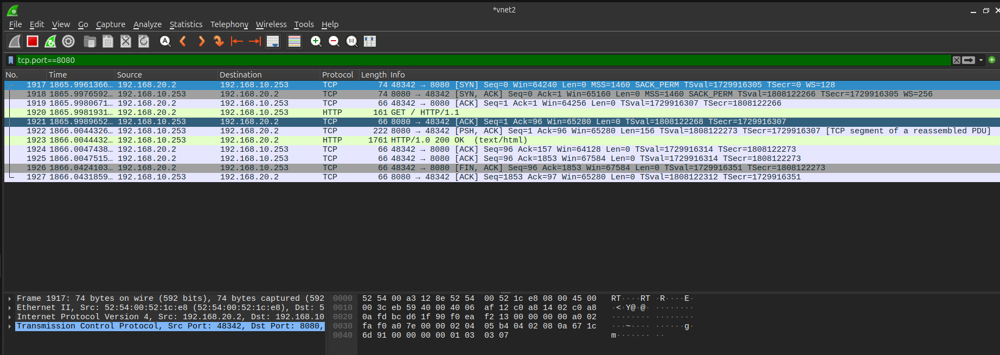
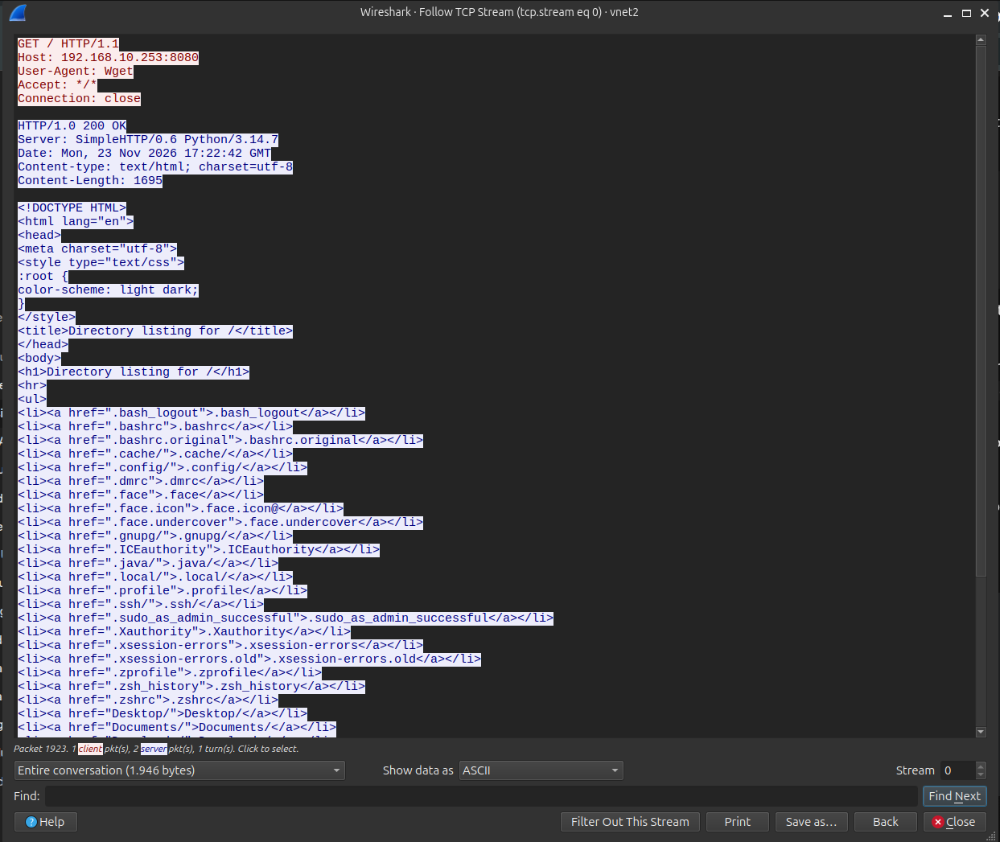

# Lab Write-up: Analysis of HTTP Request Traffic (Follow TCP Stream)

- **Focus:** Network Traffic Analysis (Wireshark), HTTP Protocol, Inter-VLAN Traffic & Stateful Firewall Behavior
- **Host OS:** Ubuntu (Native Dual-Boot)
- **Hypervisor:** KVM (`virbr0` on Ubuntu for internet access via NAT)

## Lab Topology
- **Router:** MikroTik RouterOS (inside KVM) connected to the internet via Ubuntu's `virbr0`.
- **VLAN10:** Ubuntu virtual switch (Linux bridge `br-vlan`) connected to Kali Linux inside KVM.
- **VLAN20:** Ubuntu virtual switch (Linux bridge `br-vlan01`) connected to Alpine Linux inside KVM.
- **Tools:** MikroTik RouterOS, Wireshark, Python (`http.server`), and `wget`.
- **Objective:** To analyze unencrypted HTTP request/response traffic across VLANs in Wireshark using the **Follow TCP Stream** feature, while verifying stateful inter-VLAN firewall behavior from VLAN20 to VLAN10.

## Topology & Initial Configuration
- **MikroTik RouterOS:**
  - **Firewall Filter:** Allow `established` & `related` connections, drop `invalid` connections, and block new traffic initiated from VLAN10 to VLAN20 (asymmetric stateful firewall).
  - **Interfaces & Routing:** `Bridge-LAN` with VLAN interfaces (VLAN10 & VLAN20) configured for inter-VLAN routing.
  - **Static ARP Table:** Enabled
  - **Static DHCP:** Enabled
- **Kali Linux (VLAN10):** Subnet `192.168.10.0/24`, IP `192.168.10.253`, Gateway `192.168.10.1`
- **Alpine Linux (VLAN20):** Subnet `192.168.20.0/24`, IP `192.168.20.2`, Gateway `192.168.20.1`
- **NAT:** `virbr0` (Ubuntu host)

## Steps
1. **Kali Linux (VLAN10):** Start a local HTTP server on port `8080` using `python3`:
   ```bash
   python3 -m http.server 8080
   ```

2. **Alpine Linux (VLAN20):** Send an HTTP GET request to port 8080 on Kali Linux using wget:
   ```bash
   wget http://192.168.10.253:8080
   ```

3. **Wireshark Capture (Ubuntu Host):** Capture traffic on the VLAN20 virtual bridge/interface (br-vlan01 / corresponding vnet interface for ether3 VLAN20) and apply the display filter:
   ```text
   tcp.port == 8080
   ```

## Findings

1. **TCP Session & Stateful Firewall Verification:** The connection from Alpine Linux (192.168.20.2) to Kali Linux (192.168.10.253:8080) completed a full TCP 3-way handshake (SYN → SYN, ACK → ACK), transferred the HTTP payload, and closed cleanly (FIN, ACK). Return packets from VLAN10 to VLAN20 were permitted because they matched the MikroTik established,related firewall rule.
<p align="center">
  
</p>

2. **Cleartext HTTP Exposure:** Inspecting the session via Wireshark's Follow TCP Stream feature confirmed that HTTP transmits both request headers (GET / HTTP/1.1, User-Agent: Wget) and server response contents entirely in plaintext without encryption.

<p align="center">
  
</p>

## Conclusion

HTTP traffic initiated from Alpine Linux (192.168.20.2, VLAN20) to the Python HTTP server on Kali Linux (192.168.10.253:8080, VLAN10) traverses the MikroTik router successfully without triggering the VLAN10-to-VLAN20 drop rule, demonstrating proper stateful firewall enforcement via established,related connection tracking. Filtering on tcp.port == 8080 and reconstructing the session with Follow TCP Stream in Wireshark highlights that unencrypted HTTP exposes headers and payloads in cleartext—reinforcing the necessity of TLS/HTTPS encryption alongside network segmentation and packet-level visibility in SOC monitoring.